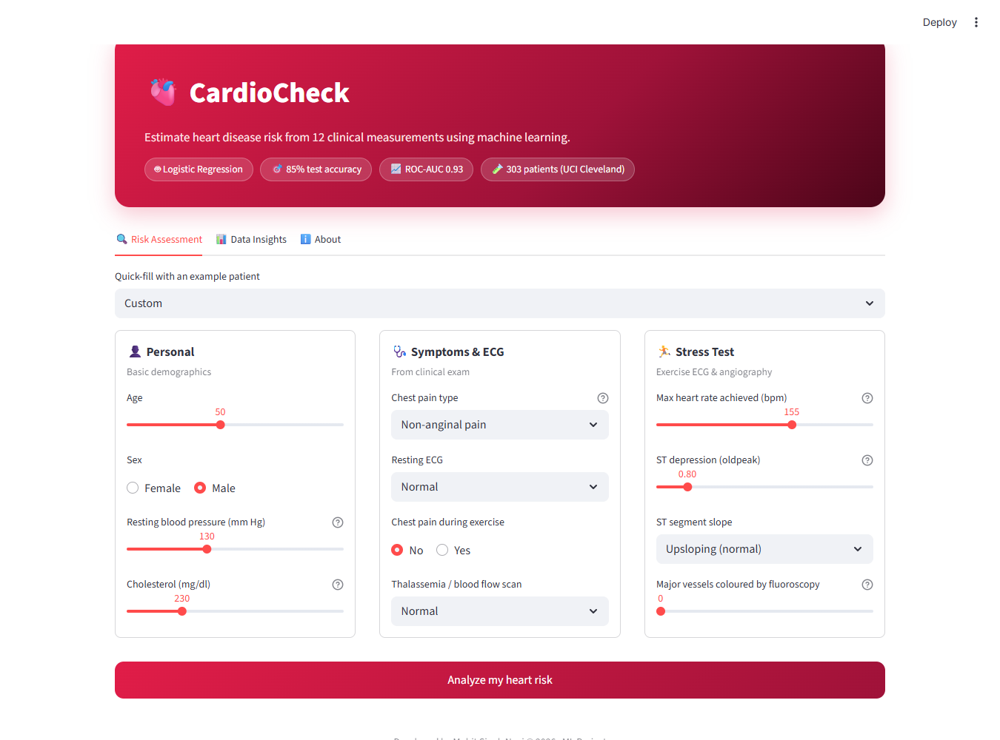
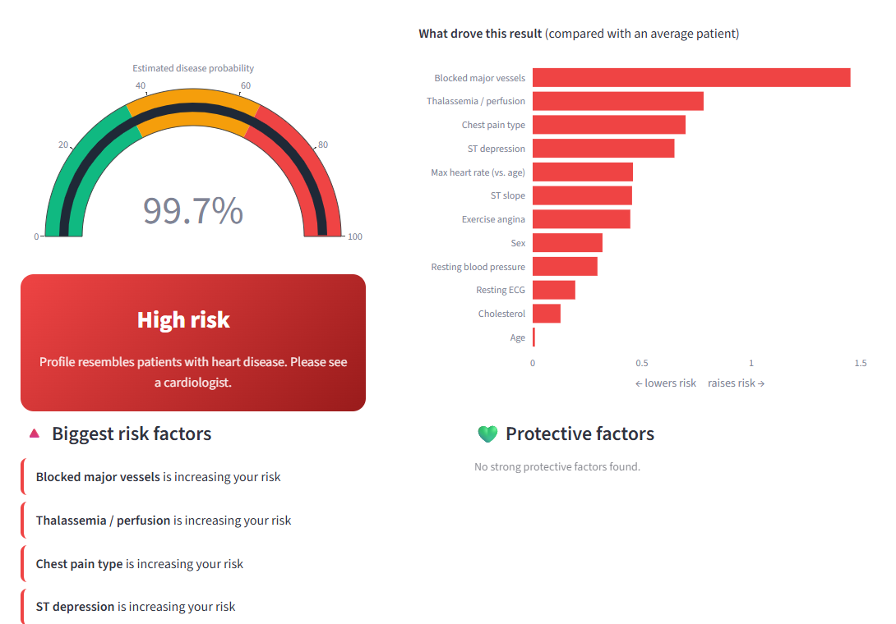

# 🫀 CardioCheck: Heart Disease Risk Prediction

A machine learning web app that estimates a patient's risk of heart disease from 12 clinical
measurements, and **explains which factors drove the prediction**.



<!-- After deploying, add: **🔗 Live demo:** https://your-app.streamlit.app -->

## ✨ Features

- **Risk prediction** with a probability gauge (low / moderate / high)
- **Explainable results:** a chart showing which inputs raised or lowered *this* patient's risk
- **Example patients** (fit, average, high-risk) to try the app in one click
- **Data insights tab:** interactive charts comparing healthy and diseased patients
- Clean, reproducible training pipeline (`train.py`) shared by the notebook and the app



## 🔍 Key finding: the dataset's labels are inverted

The first version of this model predicted **97.5% disease risk for a fit 30-year-old**.
Investigating showed that in this (Kaggle) copy of the UCI Cleveland dataset, the `target`
column is reversed: **`1` = healthy, `0` = disease**.

| Patients with… | `target = 1` | `target = 0` |
|---|---|---|
| Average age | 52.5 | 56.6 |
| Average max heart rate | 158 bpm | 139 bpm |
| Average ST depression | 0.6 | 1.6 |

The healthier-looking group is labelled `1`. After training on `disease = 1 − target`,
the same fit person gets **~4% risk**, and test accuracy rose from 80% to 85%.

Other data fixes:
- Category codes re-mapped to the correct meanings (e.g. `thal`: 2 = normal, not 1)
- Missing-value codes (`ca = 4`, `thal = 0`) imputed instead of treated as real values
- **Feature engineering:** max heart rate expressed as % of age-predicted max
  (`thalach / (220 − age)`); fasting blood sugar dropped (no signal). Without this, the model
  treated older age and high blood sugar as *protective*.

## 📊 Results

| Metric | Score |
|---|---|
| Test accuracy | **85.2%** |
| Test ROC-AUC | **0.93** |
| 5-fold CV ROC-AUC | 0.91 |

Logistic Regression was chosen over Random Forest: it scores within 0.01 ROC-AUC and its
coefficients make every prediction explainable.

## 🛠️ Tech stack

Python · pandas · NumPy · scikit-learn · Streamlit · Plotly · Matplotlib / Seaborn (EDA)

## 📁 Project structure

```
├── app.py                  # Streamlit web app
├── train.py                # Data cleaning, feature engineering, model training
├── data/
│   └── heart_disease_data.csv
├── model/
│   ├── heart_disease_model.pkl   # Trained pipeline (preprocessing + model)
│   └── model_info.json           # Metrics and metadata
├── notebooks/
│   └── heart_disease.ipynb       # EDA and model development
├── assets/                 # Screenshots
├── requirements.txt
└── README.md
```

## ▶️ How to run

```bash
git clone https://github.com/<your-username>/heart-disease-prediction.git
cd heart-disease-prediction
pip install -r requirements.txt

python train.py          # optional: retrain the model
streamlit run app.py
```

## 📚 Dataset

[UCI Heart Disease (Cleveland)](https://archive.ics.uci.edu/dataset/45/heart+disease), 303 patients,
via the Kaggle "Heart Disease Dataset" copy. 165 patients without disease, 138 with disease.

| Feature | Description |
|---|---|
| age, sex | Demographics |
| cp | Chest pain type |
| trestbps | Resting blood pressure (mm Hg) |
| chol | Serum cholesterol (mg/dl) |
| restecg | Resting ECG result |
| thalach | Max heart rate achieved |
| exang | Exercise-induced angina |
| oldpeak | ST depression induced by exercise |
| slope | Slope of peak exercise ST segment |
| ca | Number of major vessels coloured by fluoroscopy |
| thal | Thallium stress test result |

## ⚠️ Limitations

- Small dataset (303 patients), all of whom were referred for heart testing, so it does not
  represent the general population.
- Several inputs require clinical tests (fluoroscopy, thallium scan, exercise ECG).
- **Educational project only, not medical advice.**

## 🔮 Future improvements

- Train on the full multi-hospital UCI dataset (Cleveland, Hungary, Switzerland, VA)
- Add SHAP explanations and probability calibration
- Unit tests and CI with GitHub Actions

## 👤 Author

**Mohit Singh Negi**

<!-- Add your LinkedIn / GitHub links here -->

## 📄 License

[MIT](LICENSE)
