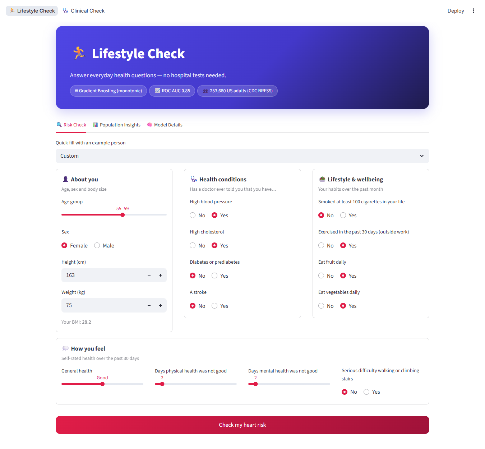
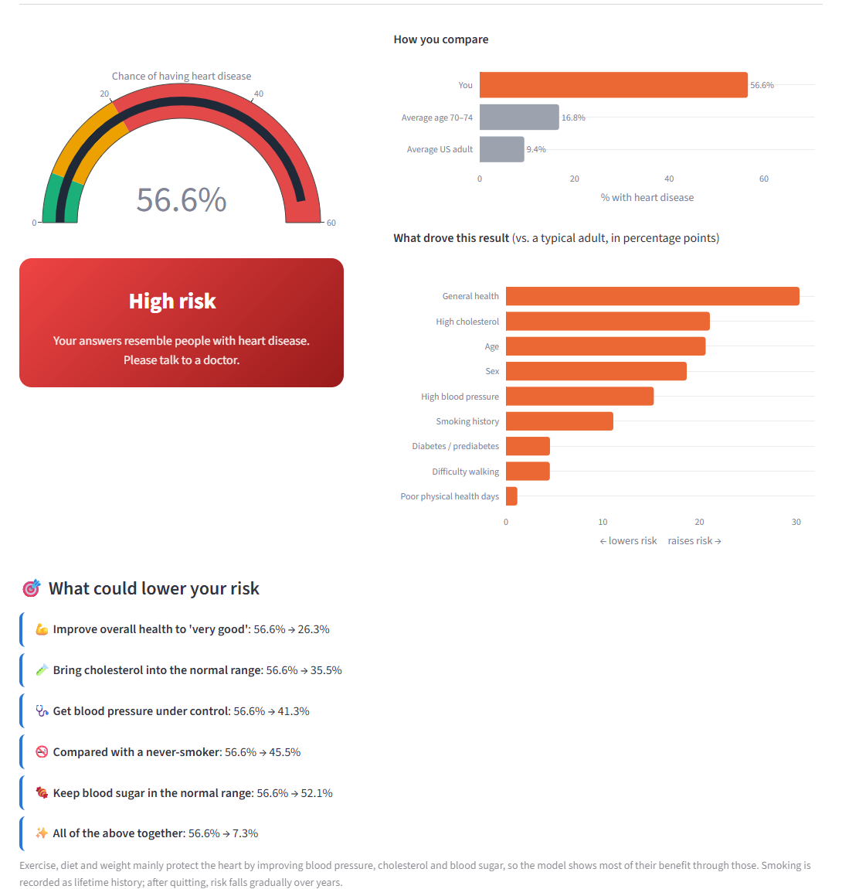
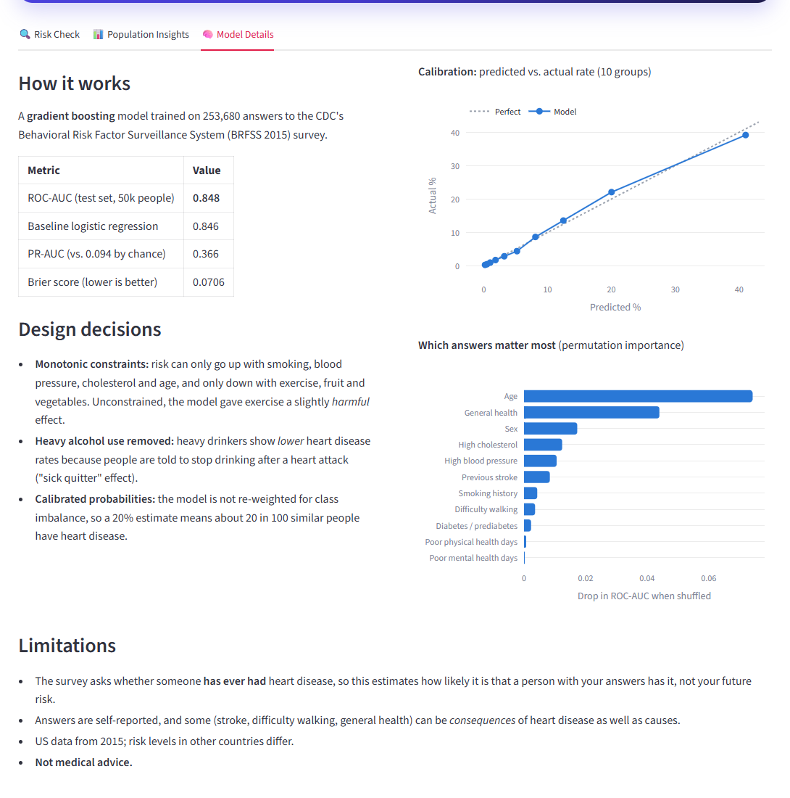

# 🫀 CardioCheck: Heart Disease Risk Prediction

A two-part machine learning web app that estimates heart disease risk and **explains what drives it**:

| | 🏃 **Lifestyle Check** (v2) | 🩺 **Clinical Check** (v1) |
|---|---|---|
| Who it's for | Anyone: everyday health questions | Patients with hospital test results |
| Data | CDC BRFSS survey, **253,680 US adults** | UCI Cleveland, 302 cardiac patients |
| Model | Gradient boosting with monotonic constraints | Logistic regression |
| Score | ROC-AUC **0.85**, well calibrated | ROC-AUC **0.93**, 85% accuracy |



<!-- After deploying, add: **🔗 Live demo:** https://your-app.streamlit.app -->

## ✨ Features

- **Risk estimate** with a gauge and a comparison against people of the same age
- **Explainable results:** which answers raised or lowered *this* person's risk
- **"What could lower your risk":** what-if scenarios such as "control blood pressure: 56.6% → 41.3%"
- **Example people** (fit, typical, high-risk) to try it in one click
- **Population insights** and **model details** tabs (calibration curve, feature importance)
- Colour-blind-safe charts (blue/orange palette, validated)



## 🔍 Key findings from the data work

The most valuable part of this project was finding problems in the data that would have made
the app give wrong or harmful answers.

### Clinical data: the labels were inverted
The first model predicted **97.5% disease risk for a fit 30-year-old**. In this (Kaggle) copy
of the UCI Cleveland dataset, the `target` column is reversed: **`1` = healthy, `0` = disease**.

| Patients with… | `target = 1` | `target = 0` |
|---|---|---|
| Average age | 52.5 | 56.6 |
| Average max heart rate | 158 bpm | 139 bpm |
| Average ST depression | 0.6 | 1.6 |

After training on `disease = 1 − target`, the same person gets **~4% risk**, and test accuracy
rose from 80% to 85%. Other fixes:
- Category codes re-mapped to the correct meanings (e.g. `thal`: 2 = normal, not 1)
- Missing-value codes (`ca = 4`, `thal = 0`) imputed; 1 duplicate patient removed
- Max heart rate expressed as % of age-predicted max (`thalach / (220 − age)`) and fasting
  blood sugar dropped. Without this, the model treated older age and high blood sugar as *protective*.

### Lifestyle data: confounding traps
- **Heavy drinkers had *lower* heart disease rates** (5.9% vs 9.6%): the "sick quitter" effect,
  because people stop drinking after a heart attack. The feature was removed so the app never
  suggests alcohol protects the heart.
- **Unconstrained models gave exercise a slightly harmful effect.** Monotonic constraints force
  risk to only rise with smoking, blood pressure, cholesterol and age, and only fall with exercise,
  fruit and vegetables, at no cost in accuracy (0.848 vs 0.848).
- Once blood pressure, cholesterol, diabetes and general health are known, **BMI, exercise and diet
  add almost no extra signal**: their benefit shows up *through* those conditions.



## 📊 Results

**Lifestyle model** (held-out test set of 50,736 people)

| Metric | Score |
|---|---|
| ROC-AUC | **0.848** (logistic regression baseline: 0.846) |
| PR-AUC | 0.366 (vs. 0.094 by chance) |
| Brier score | 0.071 |
| Calibration | Predicted 20% → actual 22% |

**Clinical model** (61 test patients)

| Metric | Score |
|---|---|
| Accuracy | **85.2%** |
| ROC-AUC | **0.93** |
| 5-fold CV ROC-AUC | 0.91 |


## ⚠️ Data limitations

**Clinical (UCI Cleveland)**
- Only 302 patients, so the test set is 61 people and accuracy could realistically be anywhere from 76% to 94%.
- All patients were **referred for heart testing**: not the general public. That's why "no
  chest pain" shows the highest disease rate (silent cases referred for other reasons).
- Only 16 patients under 40, and twice as many men as women.
- Several inputs need hospital tests (fluoroscopy, thallium scan, exercise ECG). Data from 1988.

**Lifestyle (CDC BRFSS 2015)**
- The survey asks whether someone **has ever had** heart disease, so the model estimates how likely
  a person with these answers has it, not their future risk.
- Self-reported answers; some (stroke, difficulty walking) can be consequences as well as causes.
- US data from 2015.

**Educational project only, not medical advice.**

## 🛠️ Tech stack

Python · pandas · NumPy · scikit-learn · Streamlit · Plotly · Matplotlib / Seaborn (EDA)

## 📁 Project structure

```
├── app.py                  # Streamlit entry point (navigation between pages)
├── ui.py                   # Shared styling and chart helpers
├── views/
│   ├── lifestyle.py        # Lifestyle Check page (v2)
│   └── clinical.py         # Clinical Check page (v1)
├── train.py                # Clinical model: cleaning, feature engineering, training
├── train_lifestyle.py      # Lifestyle model: downloads CDC data, trains, evaluates
├── data/
│   └── heart_disease_data.csv    # (CDC data is downloaded automatically, not committed)
├── model/                  # Trained models + metrics/insights JSON
├── notebooks/
│   └── heart_disease.ipynb       # EDA and clinical model development
├── assets/                 # Screenshots
└── requirements.txt
```

## ▶️ How to run

```bash
git clone https://github.com/MohitSinghNegi007/heart-disease-prediction.git
cd heart-disease-prediction
pip install -r requirements.txt

streamlit run app.py

# optional: retrain the models
python train.py
python train_lifestyle.py   # downloads the CDC data (~13 MB) on first run
```

## 📚 Datasets

- **[CDC Diabetes Health Indicators](https://archive.ics.uci.edu/dataset/891/cdc+diabetes+health+indicators)**
  (UCI ML Repository): 253,680 responses to the CDC's 2015 Behavioral Risk Factor Surveillance
  System survey. Target: `HeartDiseaseorAttack`.
- **[UCI Heart Disease (Cleveland)](https://archive.ics.uci.edu/dataset/45/heart+disease)**, via the
  Kaggle "Heart Disease Dataset" copy: 302 unique patients, 13 clinical attributes.

## 🔮 Future improvements

- Train the clinical model on all four UCI hospitals (Cleveland, Hungary, Switzerland, VA)
- Add a 10-year risk model using the Framingham Heart Study
- Unit tests and CI with GitHub Actions

## 👤 Author

**Mohit Singh Negi**

[GitHub](https://github.com/MohitSinghNegi007)

## 📄 License

[MIT](LICENSE)
